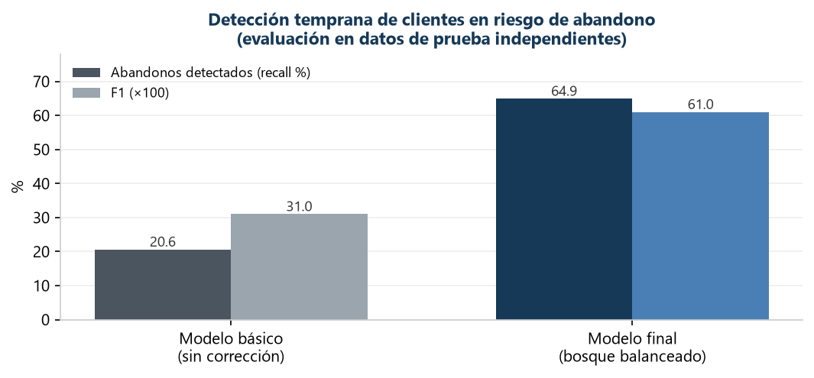

# Predicción de abandono de clientes bancarios (Churn Analytics)

> **Caso de estudio didáctico** de análisis de negocio aplicado con ciencia de datos: identificación temprana de clientes con riesgo de abandono para apoyar estrategias de retención en una institución bancaria.
>
> Este repositorio documenta **metodología, herramientas, visualización y toma de decisiones** siguiendo buenas prácticas de la industria, e incluye una [sección didáctica](#5-qué-puede-hacer-un-banco-con-esta-analítica) sobre sus aplicaciones bancarias para público general. El código fuente no se publica (ver [sección 8](#8-nota-sobre-el-código)).

---

## 1. El problema de negocio

Un banco observa la **pérdida progresiva de clientes**. Retener a un cliente actual resulta menos costoso que captar uno nuevo, por lo que la pregunta de negocio es:

> **¿Qué clientes tienen mayor probabilidad de abandonar la institución, de modo que el equipo de retención pueda actuar antes de que se vayan?**

Este proyecto responde esa pregunta con un **modelo predictivo de clasificación** entrenado sobre el comportamiento histórico de **10,000 clientes**, y —lo más importante— traduce los resultados a **decisiones de negocio accionables**.

---

## 2. Beneficios para el negocio

| Beneficio | Descripción |
|---|---|
| 🎯 **Priorización de retención** | El modelo identifica a los clientes con mayor riesgo de abandono, permitiendo concentrar los esfuerzos (y el presupuesto) de retención donde más impacto tienen. |
| 💰 **Asignación eficiente de recursos** | Con una precisión del 58 % en las alertas, el equipo de retención sabe que ~6 de cada 10 contactos corresponden a clientes que realmente iban a abandonar. |
| 📉 **Detección temprana** | Se detecta el **65 % de los abandonos reales** antes de que ocurran, frente a solo un 21 % con un enfoque analítico básico sin corrección del desequilibrio de datos. |
| 📊 **Decisiones basadas en evidencia** | Cada conclusión se acompaña de métricas, matrices de confusión y análisis de errores, con limitaciones cuantificadas explícitamente. |
| ⚖️ **Cultura de riesgo y cumplimiento** | El análisis documenta qué puede y qué no puede afirmarse a partir de los datos: el modelo prioriza riesgo, pero no demuestra por sí solo la rentabilidad de las acciones de retención. |

### Impacto medible del enfoque analítico

| Enfoque | Abandonos detectados (recall) | F1 |
|---|---|---|
| Modelo básico sin corrección | 20.6 % | 0.31 |
| **Modelo final seleccionado** | **64.9 %** | **0.61** |

> El enfoque final **triplica la capacidad de detección** de clientes en riesgo respecto al análisis básico, manteniendo un equilibrio aceptable entre detección y falsas alarmas.

---

## 3. Metodología y buenas prácticas

El proyecto sigue un flujo de trabajo estándar de la industria para analítica predictiva, con énfasis en **buenas prácticas de ciencia de datos aplicada a negocio**:

1. **Comprensión del negocio y de los datos** — 10,000 registros de clientes con 13 características (saldo, antigüedad, productos contratados, actividad, geografía, demografía). Cada campo se contrasta con su diccionario de datos antes de usarse.
2. **Preparación y calidad de datos** — tratamiento de valores ausentes, codificación de variables categóricas, escalado y partición estratificada en entrenamiento / validación / prueba, con controles explícitos contra la **fuga de información** (*data leakage*): todo estadístico de preprocesamiento se aprende únicamente del conjunto de entrenamiento.
3. **Diagnóstico del desequilibrio de clases** — solo el 20 % de los clientes abandona; se demuestra con evidencia por qué la exactitud es una métrica engañosa en este contexto y se justifica la elección de F1 como métrica principal.
4. **Comparación sistemática de modelos** — regresión logística, árboles de decisión y bosques aleatorios, con dos técnicas de balanceo (pesos de clase y sobremuestreo); selección por F1 de validación con AUC-ROC como complemento y análisis de sobreajuste.
5. **Evaluación final independiente** — el modelo seleccionado se evalúa **una sola vez** sobre datos nunca utilizados en entrenamiento ni selección, y sus errores se traducen a consecuencias de negocio.

> 📘 Detalle metodológico completo en [docs/metodologia.md](docs/metodologia.md).

### Buenas prácticas aplicadas

| Práctica | Cómo se aplicó |
|---|---|
| **Reproducibilidad** | Semillas fijas, particiones documentadas y verificación estructural de los datos antes de modelar. |
| **Prevención de fuga de información** | Imputación, codificación y escalado ajustados solo con entrenamiento; prueba intacta hasta la evaluación final. |
| **Selección honesta de métricas** | F1 como métrica principal por el desequilibrio de clases; AUC-ROC como complemento, no como sustituto. |
| **Análisis de errores** | Matriz de confusión interpretada en términos de costos de negocio (falsas alarmas vs. abandonos no detectados). |
| **Limitaciones explícitas** | Cada conclusión declara qué puede y qué no puede afirmarse a partir de los datos. |

---

## 4. Resultados

Evaluación final sobre **2,000 clientes** nunca vistos por el modelo:

| Exactitud | Precisión | Recall | F1 | AUC-ROC |
|---|---|---|---|---|
| 83.4 % | 58.2 % | 64.9 % | **0.613** | **0.857** |

**Lectura de negocio:**

- De cada 100 clientes que abandonan, el modelo **detecta 65 a tiempo**.
- De cada 100 alertas generadas, **58 corresponden a abandonos reales**.
- El análisis de errores cuantifica el costo de las falsas alarmas (contactos innecesarios) frente al costo de los abandonos no detectados, insumo directo para decidir el umbral de intervención.

### Visualizaciones clave del análisis

El proyecto utiliza visualización como herramienta de **toma de decisiones**, no solo de presentación:

| Gráfica | Decisión que apoya |
|---|---|
| **Distribución de la variable objetivo** | Evidencia el desequilibrio 80/20 y justifica abandonar la exactitud como métrica de referencia. |
| **Curva ROC** | Muestra la capacidad de discriminación del modelo a través de todos los umbrales posibles; permite comparar modelos sin fijar un punto de corte. |
| **Matriz de confusión** | Traduce aciertos y errores a consecuencias operativas: falsas alarmas (costo de contacto) vs. abandonos no detectados (costo de pérdida). |
| **Comparativa de modelos (F1 / AUC-ROC)** | Sustenta la selección del modelo final con evidencia cuantitativa sobre el mismo conjunto de validación. |
| **Análisis de sobreajuste (entrenamiento vs. validación)** | Documenta la brecha de desempeño y orienta la confianza en la generalización del modelo. |

---

## 5. ¿Qué puede hacer un banco con esta analítica?

*Sección didáctica para público en general: cómo un caso de estudio como este se conecta con la operación real de una institución bancaria.*

### Lo que los bancos ya hacen hoy con este tipo de modelos

| Aplicación | Descripción para público general |
|---|---|
| **Retención de clientes** | Detectar a tiempo quién está por irse y ofrecerle atención personalizada, mejores condiciones o resolver el problema que lo aleja, antes de que cierre su cuenta. |
| **Segmentación inteligente** | Agrupar clientes por comportamiento (no solo por saldo o edad) para comunicar lo relevante a cada grupo, en lugar de campañas masivas genéricas. |
| **Asignación eficiente del presupuesto comercial** | Concentrar incentivos y promociones en los clientes donde realmente cambian la decisión, en lugar de ofrecer descuentos a quienes de todos modos se quedarían. |
| **Medición de la salud de la cartera** | Convertir el abandono en un indicador monitoreable, con alertas tempranas por segmento, región o producto. |

### Lo que un banco podría hacer a continuación (roadmap analítico)

| Siguiente paso | Valor de negocio |
|---|---|
| **Scoring de riesgo de abandono mensual** | Pasar de un análisis único a un monitoreo continuo: cada cliente recibe una puntuación de riesgo que se actualiza con su actividad reciente. |
| **Optimización del umbral por costo-beneficio** | Decidir con números cuántas falsas alarmas conviene tolerar según el costo de contactar vs. el valor de retener a cada segmento. |
| **Modelos de recomendación** | No solo predecir quién se va, sino sugerir **qué ofrecerle**: el producto o beneficio con mayor probabilidad de retenerlo. |
| **Analítica de causas (drivers de abandono)** | Identificar qué factores explican el riesgo (inactividad, comisiones, atención) para atacar la causa raíz, no solo el síntoma. |
| **Experimentación controlada (A/B testing)** | Medir si las acciones de retención realmente funcionan, comparando grupos con y sin intervención — cerrando el ciclo entre predicción y rentabilidad. |

### Por qué importa la parte humana

Un modelo no retiene clientes: **las personas y las decisiones sí**. El valor de esta analítica está en darle al equipo de negocio información oportuna, priorizada y comprensible para actuar. Por eso este proyecto pone tanto énfasis en la interpretación de errores, las limitaciones y la comunicación clara como en las métricas técnicas.

---

## 6. Herramientas utilizadas

| Herramienta | Uso en el proyecto |
|---|---|
| **Python** | Lenguaje principal del análisis y el modelado. |
| **Pandas / NumPy** | Minería, limpieza, transformación y validación de datos. |
| **scikit-learn** | Modelado supervisado: regresión logística, árboles de decisión, bosques aleatorios, balanceo de clases, métricas y partición estratificada. |
| **Matplotlib** | Visualizaciones para diagnóstico y toma de decisiones (distribuciones, curva ROC, matrices de confusión, comparativas). |
| **Jupyter** | Documentación ejecutable del análisis, paso a paso, con hallazgos e interpretación en cada etapa. |

## 7. Habilidades demostradas

Este proyecto ejemplifica las competencias de un **Data Science / Business Analytics Analyst**:

- **Análisis estratégico de datos**: identificación de insights e implicaciones de negocio, con recomendaciones y limitaciones explícitas.
- **Minería y preparación de datos**: calidad de datos, tratamiento de ausentes, codificación y escalado con prevención de fuga de información.
- **Modelado estadístico y machine learning**: regresión logística, árboles de decisión, bosques aleatorios, balanceo de clases, selección de hiperparámetros.
- **Evaluación rigurosa**: F1, precisión, recall, AUC-ROC, matriz de confusión y análisis de errores traducido a consecuencias de negocio.
- **Comunicación de resultados**: hallazgos presentados de forma sistemática y comprensible para audiencias técnicas y no técnicas.

---

## 8. Nota sobre el código

El código fuente y los datos no se publican en este repositorio: el proyecto se desarrolló como parte de un programa de formación y el objetivo de este espacio es **documentar el enfoque analítico, los resultados y su valor de negocio** (ver [sección 1](#1-el-problema-de-negocio)). Con gusto puedo explicar la metodología y las decisiones técnicas en una entrevista o conversación técnica.

---

## Autor

**Cristóbal Antonio Hernández Juárez**
Maestro en Ingeniería Industrial · Doctorante en Finanzas y Empresa · Científico de Datos (TripleTen, en curso)

📍 Poza Rica de Hidalgo, Veracruz, México
📧 crotalushj@gmail.com
🔗 [LinkedIn](https://www.linkedin.com/in/cristóbal-hernández-5201b6277)
